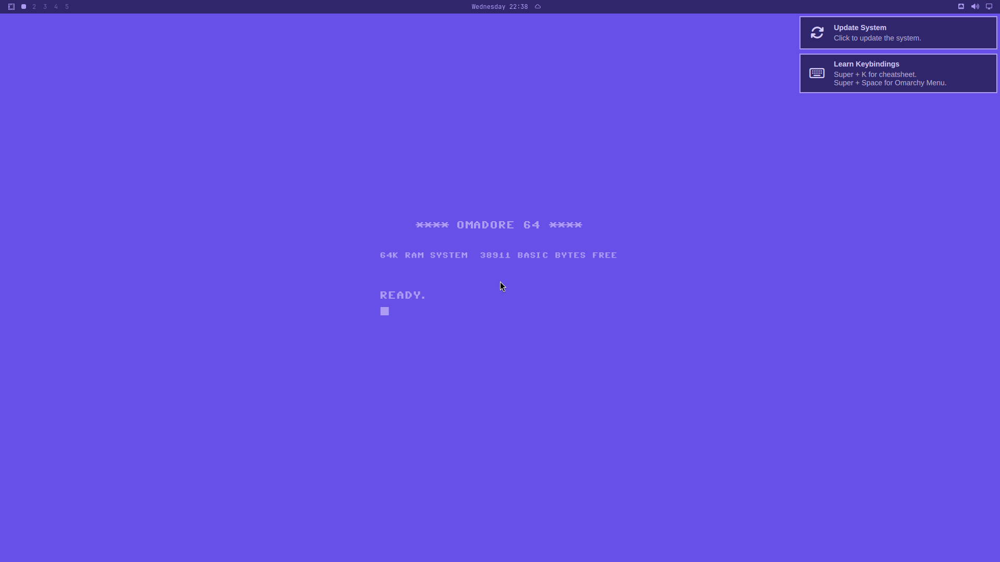

# Omadore 64

A Commodore 64-inspired theme for Omarchy. Blue-violet backgrounds, lavender accents, readable application fonts and a matching native lock-screen palette. READY.



## Install

```bash
omarchy theme install https://github.com/rogunlimited-hub/omarchy-omadore-64-theme
```

No plugins, font installation or manual configuration required. Installation applies the theme. Existing application fonts, panel placement and plugin configuration are retained. The screenshot shows a clean Omarchy installation; your existing layout may differ.

## Backgrounds

Use Omarchy's normal background picker to choose:

- **Universal READY.** — the default on a fresh installation. Centered startup text without an outer border, designed to survive center-cover cropping across common monitor formats.
- **Quiet** — plain blue-violet, without lettering.
- **Classic 16:9, 16:10, 21:9 and 32:9** — framed startup-screen alternatives. Choose the variant matching your display manually; the theme does not automatically select an aspect ratio.

Previously saved or user-provided wallpaper choices can override the initial default. Text size varies with aspect ratio and resolution. The C64 lettering is baked into the images, not applied to your applications.

## Compatibility and testing

Tested in the official Omarchy 4.0.6 virtual machine without user plugins:

| Resolution | Scale | Test |
| --- | --- | --- |
| 1920 × 1200 | 100% | Live rendering |
| 1920 × 1080 | 100% | Live rendering |
| 3440 × 1440 | 100% | Live rendering |
| 5120 × 1440 | 100% | Live rendering |
| 2560 × 1440 | 160% | Live rendering |

Additional center-cover geometry checks covered eleven resolutions, including portrait. All artwork text remained within the visible region. These checks are not a guarantee for every display geometry, mixed-DPI multi-monitor setup or older Omarchy version.

Palette acceptance checks included terminal rendering, menus, notifications, lock-screen rendering and switching to Catppuccin and back, without reported Hyprland configuration errors. Password/fingerprint authentication was not modified or tested.

## Lock screen

Standard `shell.lock.toml` colors provide a dark blue-violet input field with lavender accents over the native blurred wallpaper. No extra clock, authentication code or lock-screen plugin is installed.

## License and attribution

Theme configuration and original compositions: [MIT](LICENSE).

The artwork uses the C64 character font from [zeiche/c64font](https://github.com/zeiche/c64font), dedicated by that project to [CC0 1.0](https://creativecommons.org/publicdomain/zero/1.0/). No font installation or Commodore ROM is included.

Unofficial fan theme; not affiliated with or endorsed by Commodore or Omarchy.
